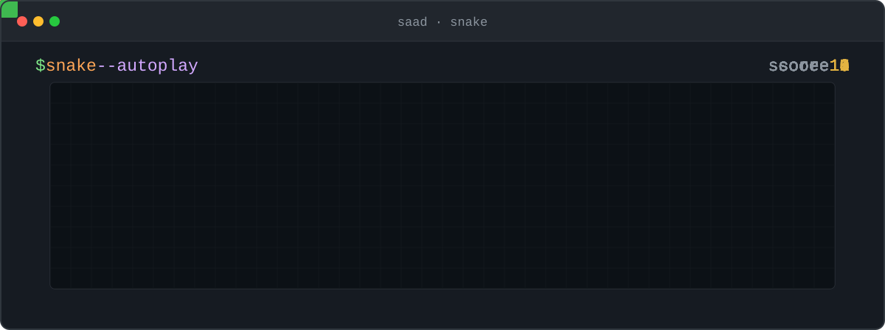
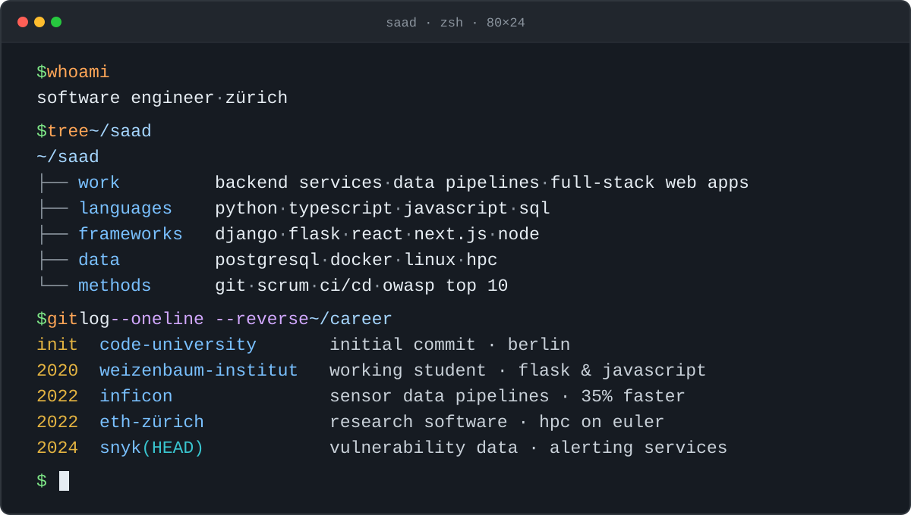
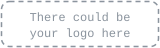
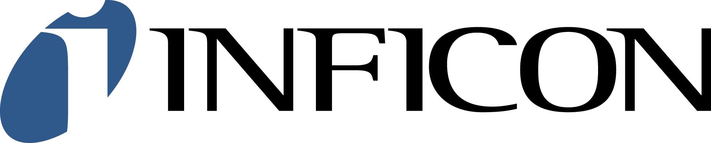

### Huh? What's that? It eats, it grows, and sooner or later it gets in its own way. Not a metaphor for software..... ok fine, a bit. But it did get your attention, so:

 

# Hi, I'm Saad :)

I'm a Software Engineer in Zürich. I build backend services, data pipelines and the web apps around them. Right now that means vulnerability data and alerting services at Snyk. Before that it was research software and HPC infrastructure at ETH Zürich. The part I enjoy most is the moment something I built turns into a tool people rely on every day.

Most of what I wrote this year sits in private repositories, so the contribution graph below is quieter than my year was. Here is the longer story.

## At work

<table>
  <tr>
    <td width="190" align="center" valign="middle"></td>
    <td valign="top"> <strong>Soon, Software Engineer at your company?</strong>   This row is still empty, which is the point. If you are reading this because of an application, that is no coincidence. 👀  </td>
  </tr>
  <tr>
    <td width="190" align="center" valign="middle"><a href="https://snyk.io"><picture><source media="(prefers-color-scheme: dark)" srcset="assets/logos/snyk-dark.svg"></picture></a></td>
    <td valign="top"> <strong>Software Engineer in an incubation team at Snyk</strong>   The team's job is to turn new ideas into things customers can use. Most of my work is Python and Django: backend services that process vulnerability data and drive customer alerting, plus the front ends that go with them in React and Next.js. The project I'm proudest of warns customers about new vulnerabilities before they hear about them anywhere else, instead of at their next scan or dashboard visit. I take features from the first design conversation to production and work with colleagues from other teams along the way.  </td>
  </tr>
  <tr>
    <td width="190" align="center" valign="middle"><a href="https://ethz.ch"><picture><source media="(prefers-color-scheme: dark)" srcset="assets/logos/eth-zurich-dark.svg"></picture></a></td>
    <td valign="top"> <strong>IT and Software Engineer at ETH Zürich</strong>   Research software, which means scientists as users and messy real data. I built web apps and data pipelines in Django and Flask that took manual steps out of the researchers' workflows, and a React app for real-time geothermal simulation so that people could model thermal settings without writing code. I also looked after our group's setup on ETH's Euler HPC cluster for large-scale reservoir simulations, and I was the person people came to when something broke, whether it was a web app, a pipeline or a compute job.  </td>
  </tr>
  <tr>
    <td width="190" align="center" valign="middle"><a href="https://www.inficon.com"><picture><source media="(prefers-color-scheme: dark)" srcset="assets/logos/inficon-dark.png"></picture></a></td>
    <td valign="top"> <strong>Software Engineering Intern at INFICON</strong>   I rebuilt and automated the data processing pipelines of the sensor manufacturing units. Processing time went down by 35%.  </td>
  </tr>
  <tr>
    <td width="190" align="center" valign="middle"><a href="https://www.weizenbaum-institut.de"><picture><source media="(prefers-color-scheme: dark)" srcset="assets/logos/weizenbaum-institut-dark.svg"></picture></a></td>
    <td valign="top"> <strong>Working Student Software Engineer at the Weizenbaum Institute</strong>   As a working student I maintained the full-stack applications in Python and JavaScript that the institute's interdisciplinary research teams used every day.  </td>
  </tr>
  <tr>
    <td width="190" align="center" valign="middle"><a href="https://code.berlin"><picture><source media="(prefers-color-scheme: dark)" srcset="assets/logos/code-university-dark.svg"></picture></a></td>
    <td valign="top"> <strong>CODE University of Applied Sciences</strong>   Along the way: second place in a telecom company's innovation challenge with a project on the future of shopping and service with XR, and a fellowship in a transatlantic German-American exchange program in Washington, D.C.  </td>
  </tr>
</table>

## On my own time

For the past half year I've been building a web app for small businesses, alone, from the first migration to the release script. It isn't launched yet, so the what has to wait. The how I can talk about: TypeScript, Express, Prisma and PostgreSQL, React in the browser, Docker Compose on a small VPS, GitHub Actions in between.

  
  
  
  
  
  

Building something alone taught me more about operations than any team project did: backups you have actually restored, migrations you can roll back, and a handbook you keep current because nobody else will.

## What I work with

| Area | Tools |
|---|---|
|  |     |
|  |      |
|  |    |
|  |      |
|  |      |

## How I like to work

<table>
  <tr>
    <td width="50%" valign="top"><strong>Ship small, finished things</strong> I'd rather ship a small thing that works and is documented than a big thing that is almost done.</td>
    <td width="50%" valign="top"><strong>Test against the real database</strong> Tests against the real database rather than mocks, wherever that is affordable.</td>
  </tr>
  <tr>
    <td valign="top"><strong>The boring parts are the product</strong> Backups, migrations, logging, deploy scripts, and documentation that stays current.</td>
    <td valign="top"><strong>Security from the first commit</strong> Rate limits, two-factor login, no secrets in the repository, admin surfaces off the public internet. Not a phase at the end.</td>
  </tr>
</table>

